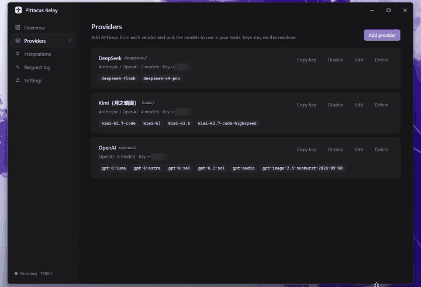

<div align="center">

# Pittacus Relay

**An API-key vault and local model gateway for your AI coding tools.**

[](https://github.com/ctrlcakepro/pittacus-relay/releases/latest)
[](LICENSE)
[](#download-and-install)

English (this page) · [简体中文](README.zh-CN.md)

[Quick Start](#quick-start) · [Features](#features) · [Download](#download-and-install) · [Supported tools](#supported-tools) · [Security](#security) · [Roadmap](#roadmap)

</div>

---

## What is Pittacus Relay?

Your providers' real API keys are locked inside Pittacus Relay. Agent tools such as Claude Code, Codex and opencode only receive a **local key that works on this computer alone and can be replaced** with one click. The gateway:

- 🔐 **Keeps real API keys secure** – never written to tool configs, environment variables, or screenshots
- 🔄 **Routes requests to any provider** – DeepSeek, Kimi, GLM, Qwen, OpenAI, Anthropic, and any OpenAI-compatible endpoint
- 🔌 **Works with your favorite AI tools** – seamlessly integrates with Claude Code, Codex, and opencode
- 📊 **Tracks API usage** – see token counts and costs across providers and time periods
- ⚡ **Local-only & fast** – runs on `127.0.0.1`, no external network calls needed for key management

<p align="center">
  
  <br>
  <sub>Connect Claude Code, check that <code>settings.json</code> holds only a local key, then switch models from <code>/model</code>. Key values are blurred.</sub>
</p>

> The name comes from Pittacus of Mytilene, one of the Seven Sages of ancient Greece. The logo is a hydra: the body is the gateway on your machine, and each head is a model provider.

---

## Quick Start

### 1. Download & Install
- **[Download the latest release →](https://github.com/ctrlcakepro/pittacus-relay/releases/latest)**
  - Windows 10/11 (x64, ARM): `.exe` installer
  - macOS (Apple Silicon or Intel): `.dmg` or `.zip`

### 2. Add Your API Keys
- Launch Pittacus Relay
- Go to **Providers** tab
- Add your DeepSeek, Kimi, OpenAI, or any OpenAI-compatible endpoint
- Paste your real API key (stored securely in OS keychain)

### 3. Connect Your Tools
- **Claude Code**: Click "Connect" on the Overview page → automatically configures `settings.json`
- **Codex**: Click "Connect" → updates `config.toml` with model catalog
- **opencode**: Click "Connect" → adds provider to config

### 4. Start Using
- In Claude Code: `/model` → pick any provider/model combo
- In Codex: `/model` → select from the unified catalog
- That's it! Real keys stay in Pittacus Relay, tools only see local keys.

---

## Why Pittacus Relay?

### The Problem
Most AI tools ask you to paste your real API key directly into their config files:
- Config gets pushed to GitHub → key is public 🚨
- Shows up in screenshots or screen recordings → compromised 🚨
- Malicious prompt injection reads env vars → key stolen 🚨
- You need to revoke keys everywhere they're used 😤

### The Solution: API-key Vault

After connecting Claude Code, what Pittacus Relay writes is this:

```jsonc
"env": {
  "ANTHROPIC_BASE_URL": "http://127.0.0.1:17800",
  "ANTHROPIC_AUTH_TOKEN": "pittacus-…"   // a local key, not any provider's key
}
```

**If your config leaks, what does the other party get?**

| Scenario | Without Pittacus | With Pittacus Relay |
|---|---|---|
| You push `settings.json` to GitHub | Provider key is public and can be abused from anywhere | Only a local key, valid only on your machine's gateway |
| It shows up in a screenshot | Same risk | Same. Click "Regenerate" and the old key is invalid instantly |
| Prompt injection reads env vars | Attacker gets your provider key | Attacker gets only a useless local key (confined to `127.0.0.1`) |
| You need to revoke | Regenerate at each provider, update everywhere | Regenerate the local key; real keys stay intact |

**Honest boundaries**: This protects against config leaks and agent-environment attacks. A malicious program running under your OS account could still access keys; this is an OS-level risk that no desktop app can fully solve.

---

## Download and Install

**[→ Get latest release](https://github.com/ctrlcakepro/pittacus-relay/releases/latest)** (SHA-256 checksums included in release notes)

| System | Installer |
|---|---|
| Windows 10/11 (x64) | `Pittacus-Relay-<version>-win-x64.exe` |
| Windows on ARM | `Pittacus-Relay-<version>-win-arm64.exe` |
| macOS, Apple silicon (M-series) | `Pittacus-Relay-<version>-mac-arm64.dmg` |
| macOS, Intel | `Pittacus-Relay-<version>-mac-x64.dmg` |

macOS also ships a `.zip` for each architecture: unzip it and drag `Pittacus Relay.app` into Applications, same result as the `.dmg`.

### First Launch

The installers are **not code-signed yet** (pending SignPath Foundation approval; see [Code signing policy](#code-signing-policy)), so your OS will stop you the first time:

- **Windows**: when SmartScreen says "Windows protected your PC", click "More info" → "Run anyway".
- **macOS**: when you see "cannot verify the developer" or "is damaged", open System Settings → Privacy & Security and click "Open Anyway" at the bottom, or run:
  ```bash
  xattr -cr "/Applications/Pittacus Relay.app"
  ```

After installation Pittacus Relay lives in the system tray (Windows) or menu bar (macOS). Closing the window does not stop the gateway. To quit, use "Quit" in the tray menu.

### Settings

**Startup options** (Settings → Startup):
- **Launch at login**: starts Pittacus Relay automatically
- **Start silently**: no main window on launch, tray only

**Appearance** (Settings → Appearance):
- Theme: follow system, light, or dark
- Accent color: brand purple or any Apple system color

**Language** (Settings → Language):
- English and Simplified Chinese (follows system by default)

---

## Features

### 🔐 Security-First Key Vault
- Real API keys encrypted with OS keychain (DPAPI on Windows, Keychain on macOS)
- Local key isolation: tools never see provider keys
- PIN protection for copying keys
- No plaintext storage, no telemetry

### 🔄 Multi-Provider Gateway
- Route requests to any provider based on model name
- Supports OpenAI, Anthropic, DeepSeek, Kimi, GLM, Qwen, Ollama, and any OpenAI-compatible endpoint
- Automatic protocol conversion (OpenAI ↔ Codex Responses API)
- Request headers rebuilt per-provider (no header leaks)

### 🔌 Tool Integrations
- **Claude Code** (v2.1.242+): auto-configure, `/model` switching
- **Codex**: full integration with model catalog sync
- **opencode**: seamless provider selection

### 📊 Usage Analytics
- Track tokens, requests, and cache hits
- Filter by time: today / 7 days / 30 days
- Per-model and per-provider breakdowns
- No conversation content logged (privacy first)

### 🎨 User-Friendly UI
- Drag-and-drop provider setup
- One-click tool connection
- Real-time gateway status
- Dark/light theme

---

## How It Works

```
Tools (hold only local key)        Vault (real keys stored encrypted)
Claude Code ──(Anthropic)──┐
Codex ──────(Responses API)├──► Pittacus Relay 127.0.0.1:17800 ──► Provider Gateway
opencode ───(OpenAI)───────┘      • Check local key
                                   • Swap in real provider key
                                   • Forward request over HTTPS
```

- **Local only**: listens on `127.0.0.1`, cross-site requests blocked
- **Model routing**: `provider-id/model` format (e.g., `kimi/kimi-k2`)
- **Protocol support**: native Anthropic and OpenAI-compatible endpoints
- **Codex conversion**: converts Responses API → Chat Completions for compatible providers
- **No OAuth forwarding**: only regular API keys aggregated

---

## Supported Tools

| Tool | What Pittacus Writes | How to Switch Models |
|---|---|---|
| Claude Code (v2.1.242+) | `env` and `modelPicker` in `~/.claude/settings.json` | `/model` command |
| Codex | `~/.codex/config.toml` + model catalog JSON | `/model` or model dropdown |
| opencode | `~/.config/opencode/opencode.json` | `pittacus/…` in model picker |

Original config values are saved; "Restore" undoes only Pittacus Relay's changes.

---

## Security

### Key Protection
- **Local only**: gateway on `127.0.0.1`, every request requires local key
- **Encrypted storage**: OS keychain (DPAPI/Keychain) protects provider keys
- **Key binding**: provider keys are tied to their address; changing the URL requires re-entering the key
- **No plaintext, no redirects**: HTTPS only (except local Ollama); redirects are errors

### Application Hardening
- Windows cannot navigate externally; IPC is restricted to Pittacus Relay's own UI
- Installer disables Electron's `RunAsNode`, `NODE_OPTIONS`, `--inspect`
- Config files readable only by current user (macOS 0600 permissions)
- PIN required to copy provider keys

### Privacy
- Request logs record only summaries and token counts, never conversation content
- No telemetry; no external phone-home calls
- Full privacy policy: see bottom of this README

### Honest Boundaries
The OS key store protects against copied config files and other OS accounts reading it. It does not defend against malicious programs running under your own OS account; that's an OS-level isolation problem no desktop app can fully solve.

---

## Development

```bash
npm install
npm run dev        # start in development mode
npm test           # unit tests
npm run typecheck
npm run build
npm run dist:win   # Windows installer → dist/
npm run dist:mac   # macOS installer (macOS only)
npm run install:win  # package + silently install locally (for testing)
```

**GitHub Actions**: Every push builds on Windows and macOS. Pushing a `v*` tag creates a draft Release with all installers.

**Architecture**:
```
src/core/      Gateway, routing, vault, tool integrations (no Electron)
src/main/      Electron main process, windows, tray, IPC
src/preload/   Secure bridge (contextIsolation + sandbox)
src/renderer/  React UI
src/shared/    Type contracts
```

**Testing**: Set `PITTACUS_RELAY_DATA_DIR`, `CLAUDE_CONFIG_DIR`, `CODEX_HOME`, or `XDG_CONFIG_HOME` to a temporary directory to test without touching your real config.

---

## Code Signing Policy

Free code signing provided by [SignPath.io](https://about.signpath.io/), certificate by [SignPath Foundation](https://signpath.org/).

- **Scope**: Windows executable and installer (pending approval)
- **Approval**: Manual review before every release
- **Maintainers**: [ctrlcakepro](https://github.com/ctrlcakepro)

---

## Roadmap

- [x] Windows / macOS installers
- [x] Codex integration
- [ ] Windows code signing (awaiting SignPath Foundation approval)
- [ ] macOS code signing and notarization
- [ ] Auto-update
- [ ] OpenAI ↔ Anthropic protocol conversion
- Idea: HarmonyOS PC edition (experimental)

---

## FAQ

**Q: Does Pittacus Relay phone home?**  
A: No. The app is local-only. It makes outbound HTTPS requests only to your configured provider endpoints. No telemetry, no analytics, no automatic updates.

**Q: What if my computer crashes or I reinstall?**  
A: Provider keys are stored encrypted in your OS keychain. They won't transfer to a new machine. Local keys can be regenerated anytime from the Overview tab.

**Q: Can I use Pittacus Relay on a server or VM?**  
A: Not yet. It's designed for desktop (Windows 10+, macOS). HarmonyOS PC support is a future idea but not scheduled.

**Q: How do I report a security issue?**  
A: Please email [security report] (TBD) instead of opening a public issue. For now, open a private security advisory on GitHub.

---

## License

[MIT](LICENSE)

---

## Privacy Policy

This program will not transfer any information to other networked systems unless specifically requested by the user or the person installing or operating it. That is:

- **No telemetry**: no usage statistics, error reporting, or analytics are sent anywhere
- **No updates**: the app does not check for or download updates (manual downloads required)
- **No configuration syncing**: your vault stays on your machine
- **Network access**: only to provider endpoints you explicitly configure
- **Storage**: all keys and configs stay on your local disk, encrypted by OS keychain

